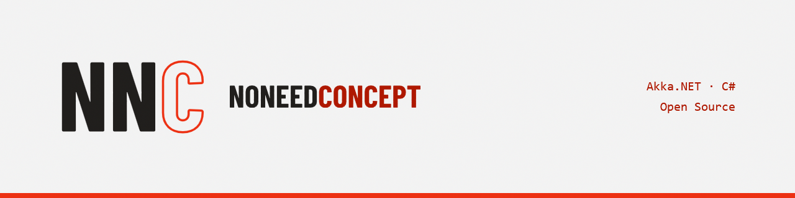

# NNC brand

NNC (NoNeedConcept) is a small open-source org of two developers building .NET software, mostly around Akka.NET. The name is ironic: we start building and don't wait for a big concept. The mark says the same thing. N N is built solid, while the C is only drawn as an outline, like a blueprint nobody finished because the software already runs.

## Mark

Monogram `NNC` set in Barlow Condensed Bold, converted to paths. N N is filled. The C is an outline only, with a stroke width of 2.2 % of the font size.

- `assets/logo/nnc-mark.svg` – ink NN + red C, default on light grounds
- `assets/logo/nnc-mark-paper.svg` – paper NN + red C, on dark grounds
- `assets/logo/nnc-mark-ink.svg` – all ink, one-colour print
- `assets/logo/nnc-mark-reverse.svg` – all paper, on red or photos
- `assets/logo/nnc-mark-1024.png`, `assets/logo/nnc-mark-paper-1024.png`
- `assets/logo/nnc-signet.svg`, `assets/logo/nnc-signet-1024.png` – red square, paper monogram

Keep clear space of at least the height of one N on all sides. Below 48 px the outline C is dropped: 32 px shows `NN`, 16 px shows `N`.

Don't fill the C, rotate, add gradients or shadows, or recolour outside the palette.

## Wordmark

`NONEEDCONCEPT`, uppercase, Barlow Condensed Bold. "NONEED" is set in ink and "CONCEPT" in red (Signal deep on paper, Signal on ink).

- `assets/logo/nnc-wordmark.svg`, `assets/logo/nnc-wordmark-paper.svg`
- `assets/logo/nnc-lockup-light.svg/.png`, `assets/logo/nnc-lockup-dark.svg/.png` – signet + wordmark, gap = 0.2 × signet

Tagline: "~~Concept~~ Code." with a red strikethrough.

## Colour

| Name | Hex | Use |
| --- | --- | --- |
| Signal | `#EC3013` | Signet, outline C, one primary action per surface, measure lines |
| Signal deep | `#AE1800` | Red text and links on paper |
| Signal light | `#FFC4B8` | Red text on ink |
| Ink | `#201E1D` | Text, dark grounds, package icons |
| Paper | `#F3F2F2` | Background |
| Grid | `#FFF2EF` | 1 px grid lines on paper (optional) |

Red is never body text. Rules are 2 px, corners are always square.

## Type

- Barlow Condensed Bold – logo, wordmark, project names only
- Archivo (400 / 800) – headings and body
- System monospace – code, package names, part numbers (`NNC/01`)

All three are free on Google Fonts. The logo files contain paths, so they don't need any font installed.

## Icons

- `assets/icon/nnc-icon.svg`, `assets/icon/nnc-icon-512.png` – org icon
- `assets/github/nnc-org-avatar-500.png` – GitHub org avatar (Settings → Profile picture)
- `assets/icon/akka-pathfinder-icon.svg/-512.png` – NNC/01 · PF
- `assets/icon/moin-akka-endpoint-icon.svg/-512.png` – NNC/03 · EP
- `assets/icon/nnc-package-template.svg` – template for new packages: replace part number and abbreviation

Package icons are the default for projects **without** their own CI: ink field, part number top left, red square top right, two-letter abbreviation.

```xml
<PackageIcon>akka-pathfinder-icon-512.png</PackageIcon>
<ItemGroup><None Include="akka-pathfinder-icon-512.png" Pack="true" PackagePath="\" /></ItemGroup>
```

## Favicon

```html
<link rel="icon" href="/favicon.svg" type="image/svg+xml">
<link rel="icon" href="/favicon-32.png" sizes="32x32">
<link rel="apple-touch-icon" href="/apple-touch-icon-180.png">
```

## GitHub and README

- `assets/github/nnc-social-preview.png` – 1280×640, for the org's `.github` repo or as a default repo social preview
- `assets/readme/readme-header-light.png`, `assets/readme/readme-header-dark.png`

```html
<picture>
  <source media="(prefers-color-scheme: dark)" srcset="assets/readme/readme-header-dark.png">
  
</picture>
```

Badges: label on ink, value on Signal (status) or neutral grey (version, licence). Square corners.

## Docs / website (VitePress)

```css
:root {
  --vp-c-brand-1: #AE1800;
  --vp-c-brand-2: #EC3013;
  --vp-c-bg: #F3F2F2;
  --vp-c-text-1: #201E1D;
  --vp-font-family-base: 'Archivo', sans-serif;
  --vp-button-brand-border-radius: 0;
}
.dark {
  --vp-c-brand-1: #FFC4B8;
  --vp-c-brand-2: #EC3013;
  --vp-c-bg: #201E1D;
  --vp-c-text-1: #F3F2F2;
}
```

Use `assets/logo/nnc-signet.svg` as `themeConfig.logo`. Sidebar entries carry part numbers (`01 Akka.Pathfinder`).

## Brand architecture

NNC is the sender, not an umbrella. A project may have its own CI (mark, colours, type), as terp does. NNC then appears only as an endorsement:

- `assets/endorsement/by-nnc-ink.svg/.png`, `assets/endorsement/by-nnc-paper.svg/.png`
- `assets/endorsement/by-nnc-current.svg` – uses `currentColor` when inlined, so it takes the project's text colour

Rules:

- Place it in the README footer, docs footer or bottom of the social preview.
- Keep it one colour in the project's text colour. Never use Signal red inside a project CI.
- Make it at most ⅓ the height of the project logo, with a minimum mark height of 16 px.
- Keep clear space equal to the stamp's height on all sides.
- Never put a project mark inside the NNC signet, or the other way round.

Part numbers: NNC/01 Akka.Pathfinder · NNC/02 terp · NNC/03 moin.akka.endpoint.
